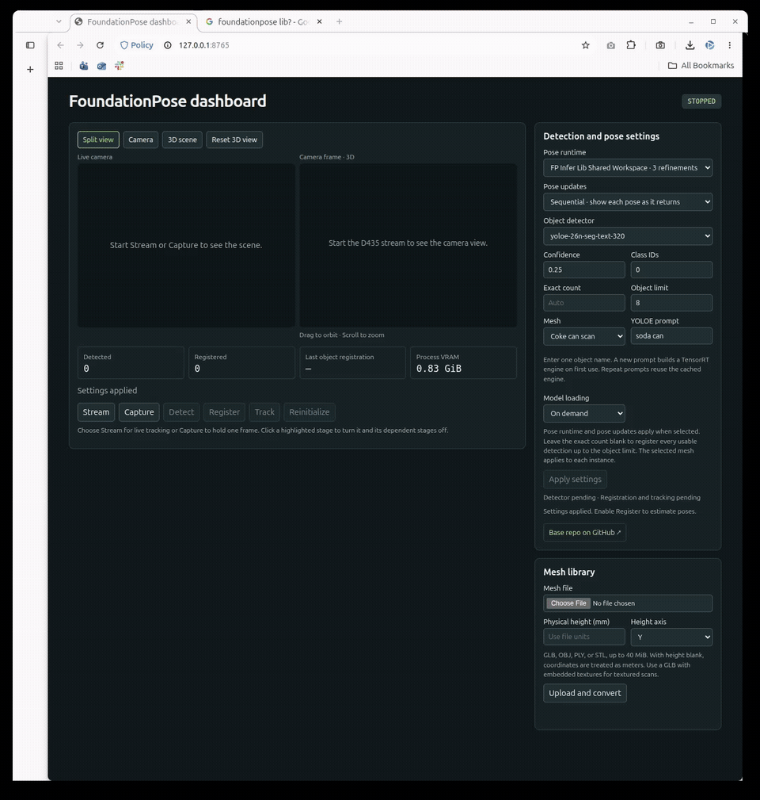
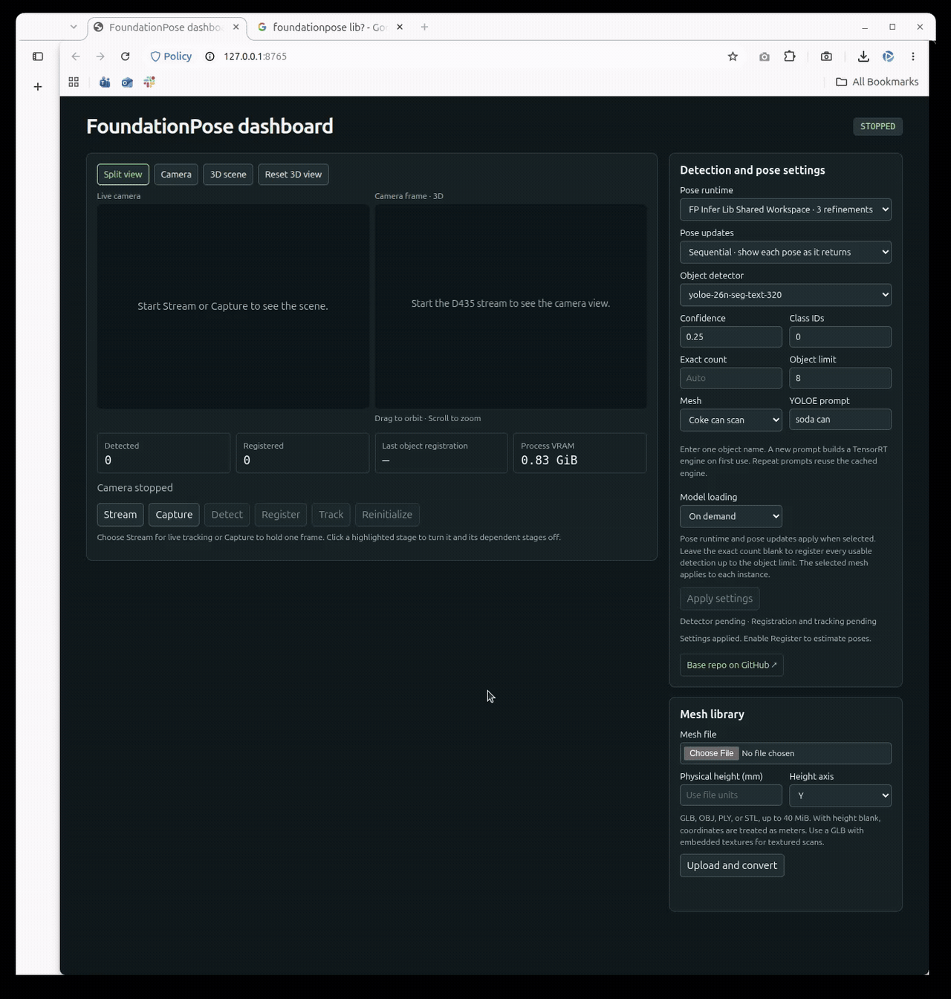
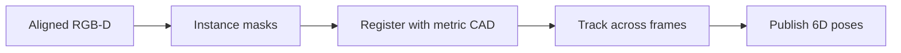

# FoundationPose Showroom


A dashboard for 6D pose registration and tracking with RGB-D cameras. View live overlays, 3D poses, latency and VRAM. Try it with the [145 mm soda-can scan](examples/soda-can/).

The three-refinement Shared Workspace build achieved:

- **107.9 ms to first pose at 3.68 GiB peak VRAM** with warmed YOLOE and one can.
- **3.45 GiB peak VRAM at 110.4 ms to first pose** with the RGB-D detector and one can.
- **342.5 ms median for three poses at 4.10 GiB peak VRAM**. That’s 35% lower latency and 63% lower peak VRAM than stock FP Infer Lib on the same frames.

Objects share the large GPU workspace. Each object adds mesh buffers and pose state. Single-can timings start with an aligned frame after setup. Peak VRAM is sampled for the process and includes setup. [Benchmark details](RESULTS.md)

> This is an independent test project, not an official NVIDIA repository. Thanks to NVlabs, NVIDIA Isaac, RealSense and Ultralytics for their work.

[Bring-up](#bring-up) · [Multiple objects](#multiple-objects-and-custom-meshes) · [Product integration](#carry-the-pipeline-into-a-product) · [Benchmarks](RESULTS.md)

## On-demand loading and preload

**On demand** loads each model when needed. **Preload** warms detection, registration and tracking when you apply settings. Preload moves first-use allocation ahead of registration. These recordings use the Shared Workspace build.

| On demand | Preload |
|---|---|
|  |  |

## Bring-up

### 1. Prepare the workstation

Use Linux, a RealSense D435 and an NVIDIA GPU with a compatible driver. Install Docker and NVIDIA Container Toolkit. Run all steps in the same shell. [Toolkit installation](https://docs.nvidia.com/datacenter/cloud-native/container-toolkit/latest/install-guide.html) · [Container requirements](https://docs.nvidia.com/deeplearning/frameworks/pytorch-release-notes/rel-26-05.html)

```bash
git clone --recurse-submodules https://github.com/leochien1110/foundationpose-showroom.git
cd foundationpose-showroom

export FP_DOCKER_IMAGE=nvcr.io/nvidia/pytorch:26.05-py3
export FP_GPU=0
export FP_CUDA_ARCHITECTURES="$(nvidia-smi -i "$FP_GPU" --query-gpu=compute_cap --format=csv,noheader | tr -d '.[:space:]')"

docker pull "$FP_DOCKER_IMAGE"
docker run --rm --gpus all --entrypoint nvidia-smi "$FP_DOCKER_IMAGE" -L
```

`FP_CUDA_ARCHITECTURES` is the compute capability without the decimal. For example, `12.0` becomes `120`. The last command checks that Docker can see the GPUs.

### 2. Prepare the runtime and build

The virtual environment uses PyTorch and TensorRT from the Docker image. Review the model terms before downloading weights.

```bash
export FP_RUNTIME_ROOT="$PWD/.build/runtime-bundle"
mkdir -p "$FP_RUNTIME_ROOT/runtime"

docker run --rm --user "$(id -u):$(id -g)" -e HOME=/tmp \
  -v "$FP_RUNTIME_ROOT:/fp" --entrypoint bash "$FP_DOCKER_IMAGE" -ec '
  python -m venv --system-site-packages /fp/runtime/venv
  py=/fp/runtime/venv/bin/python
  "$py" -m pip install opencv-python-headless==4.11.0.86 scipy trimesh pillow matplotlib pyrealsense2==2.59.2.11152
  "$py" -c "import cv2, numpy, scipy, trimesh, PIL, matplotlib, pyrealsense2, torch, tensorrt"
'

"$PWD/upstream/inference/scripts/download_weights.sh" "$FP_RUNTIME_ROOT/runtime/assets/onnx"
./run.sh build
```

To reuse a runtime, point `FP_RUNTIME_ROOT` to the directory containing `runtime/venv/bin/python` and the ONNX weights in `runtime/assets/onnx/`. The files are `refiner_net.onnx` and `score_net.onnx`. Without a prebuilt cache, the launcher stores new engines under `.models/pose-engines/`.

### 3. Run the soda-can example

```bash
./run.sh dashboard
```

1. Open [http://127.0.0.1:8765](http://127.0.0.1:8765). Select **FP Infer Lib**, **RGB-D single can** and **Coke can scan**.
2. Place one upright red-labeled can 0.4–0.6 m from the camera. Click **Stream → Detect → Register**. TensorRT may build engines during the first registration.
3. Enable **Track** and move the can slowly. To inspect a held frame, use **Capture → Detect → Register**. Click **Reinitialize** to run again on that frame.

Use `FP_GPU` to select an idle GPU and `FP_PREVIEW_PORT` to change the port. For multiple cameras, set `FP_CAMERA_USB` to the device path from `lsusb`, such as `/dev/bus/usb/004/004`.

## Multiple objects and custom meshes

Place licensed `yoloe-26n-seg.pt` and `mobileclip2_b.ts` weights in `.models/`. Use an environment with Ultralytics, CLIP, ONNX and TensorRT.

```bash
(cd .models && python ../export_detectors.py yoloe-26n-seg.pt --sizes 320 --text 'soda can')
python yolo_trt.py .models/yoloe-26n-seg-text-320.onnx .models/yoloe-26n-seg-text-320.plan
```

Restart the dashboard and select the new detector. Start with confidence `0.25` and class `0`. Leave **Exact count** blank for a changing scene. Set **Preload objects** to the expected maximum. Auto uses the latest valid count or one object on a fresh start.

Upload a GLB, OBJ, PLY or STL and set its physical height and axis if needed. Select the mesh, enter a short **YOLOE prompt** such as `plastic bottle` and click **Apply settings**. Prompt changes require the export packages in `.yolo-deps/` and the tokenizer in `.yolo-clip/`. The dashboard caches a TensorRT engine for each prompt and resolution. All detected instances use the selected mesh.

## Carry the pipeline into a product



| Step | What to carry over |
|---|---|
| [Input](capture.py) | Provide RGB `H×W×3 uint8`, aligned depth `H×W float32` in meters and `3×3` color intrinsics. Keep the frame timestamp. |
| [Masks](yolo_trt.py) and [meshes](mesh.py) | Pass an `H×W uint8` binary mask and a metric mesh per instance. Verify CAD scale, origin and axes. |
| [Pose API](benchmark.py) | Register on first sight or after tracking loss. Track on later frames. Use the group API for batch output or per-handle calls for sequential output. |
| [Runtime](dashboard.py) | Reuse a bounded set of pose slots. Warm up the models and assign stable object IDs across frames. |
| [Output](https://github.com/nvidia-isaac/foundation-pose-inference-library/blob/89dd4cfec75f944b9fca52d9cb282725f1666c12/doc/ARCHITECTURE.md) | Publish the `4×4` object-to-camera pose with frame time, instance ID and tracking status. Apply your calibrated transform for robot or world coordinates. |

Use the upstream estimator or group API in your service. Associate masks with stable IDs before updating pose slots. Decide how long a pose stays valid after a missed detection or tracking failure. [Upstream C API](https://github.com/nvidia-isaac/foundation-pose-inference-library/blob/89dd4cfec75f944b9fca52d9cb282725f1666c12/include/foundation_pose_nvidia/c_api.h)

The Shared Workspace results came from a private build. With the upstream runtime, tune RefineNet `batch_size` to trade speed for memory. It must divide `n_hypotheses`. ScoreNet still runs at full batch. Measure model setup, first-pose latency, tracking, peak VRAM and pose error on your hardware. [Upstream micro-batching guide](https://github.com/nvidia-isaac/foundation-pose-inference-library/blob/89dd4cfec75f944b9fca52d9cb282725f1666c12/README.md#memory-optimization--micro-batching)

## Replay a benchmark

The tests used a RealSense D435 and an RTX PRO 6000 Blackwell Max-Q. Stop the dashboard stream before capture. The host Python needs NumPy, OpenCV and `pyrealsense2`. [Benchmark setup and results](RESULTS.md)

```bash
python capture.py results/soda-can/d435.npz --frames 26
FP_DETECTOR=rgbd-can ./run.sh compare soda-can 0.145 1
```

The comparison replays the same captured frames for each backend. Find plots and CSV results in the session directory. Original FP also needs `original/weights/` and `original/mycpp/build/` under `FP_RUNTIME_ROOT`.

## Dependencies and terms

The submodules retain their upstream licenses. Review the relevant model and detector terms before product use. Ask the owner for permission to reuse demo code. [Original FP license](https://github.com/NVlabs/FoundationPose/blob/a1b694b83e633c2cb6115b9063d940a687759392/LICENSE) · [FP Infer Lib license](https://github.com/nvidia-isaac/foundation-pose-inference-library/blob/89dd4cfec75f944b9fca52d9cb282725f1666c12/LICENSE) · [Ultralytics licensing](https://www.ultralytics.com/license)
