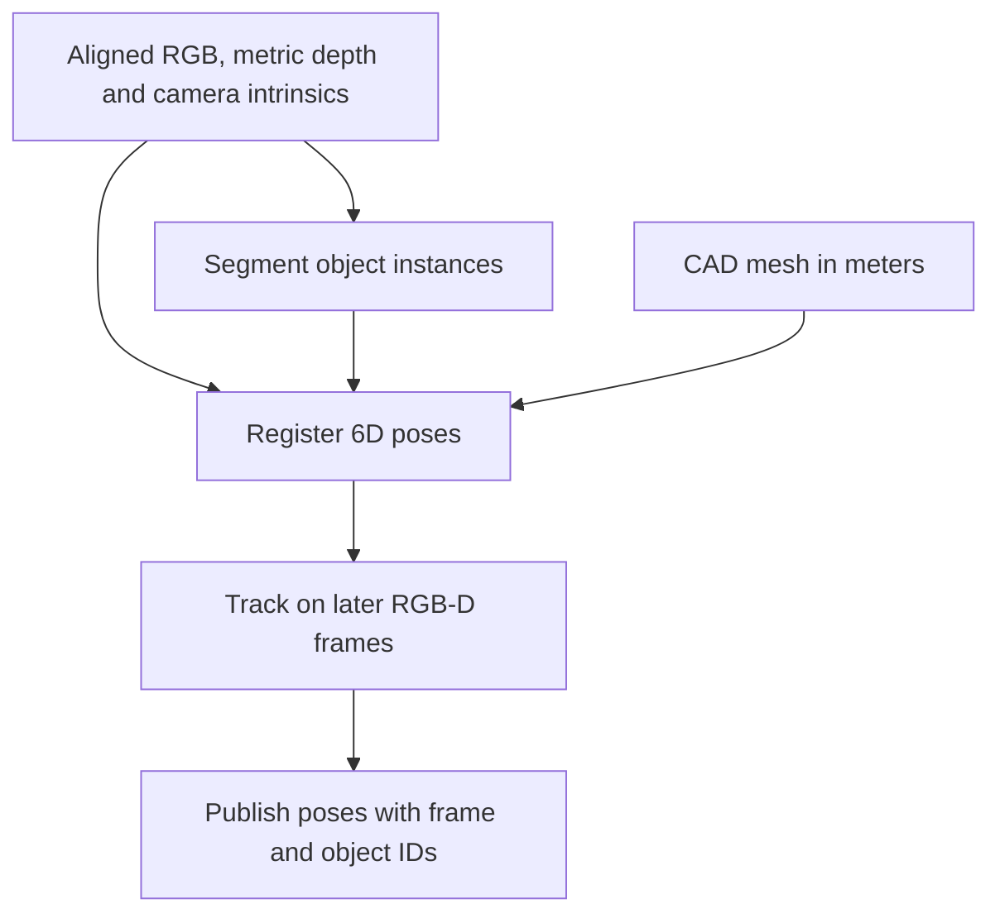

# FoundationPose Showroom

A hands-on test of 6D object pose registration and tracking with a RealSense D435. The dashboard shows the camera overlay, the estimated poses in an orbitable 3D view, registration time and GPU memory. The included example uses a [textured soda-can scan](examples/soda-can/) scaled to its measured height of 145 mm.

On a **RealSense D435** and **RTX PRO 6000 Blackwell Max-Q**, the three-refinement Shared Workspace build achieved:

- **Fastest first pose: 107.9 ms at 3.68 GiB peak VRAM** for one can with warmed YOLOE.
- **Lowest peak VRAM: 3.45 GiB at 110.4 ms to first pose** for one can with the RGB-D detector.
- **Three cans: 342.5 ms median for all poses at 4.10 GiB peak VRAM**, with 35% lower latency and 63% lower peak VRAM than stock FP Infer Lib on the same frames.

The single-can timings start with an aligned frame after model setup. VRAM is sampled process memory. [Benchmark details](RESULTS.md)

> This is an independent test project. It is not an official NVIDIA repository and is not affiliated with or endorsed by NVIDIA. Thanks to NVlabs for FoundationPose, the NVIDIA Isaac team for the FoundationPose Inference Library, and the RealSense and Ultralytics teams for the camera and detector tools used in the evaluation.

Start with one can using the built-in RGB-D detector, then try multiple cans with a text-prompted detector. The dashboard also accepts your own GLB, OBJ, PLY, or STL mesh.

[Live demos](#live-demos) · [Bring-up](#bring-up) · [Multiple objects](#multiple-objects-and-custom-meshes) · [Product integration](#carry-the-pipeline-into-a-product) · [Benchmark results](RESULTS.md)

## Live demos

### Live tracking with a changing object count

The dashboard detects cans as they enter the scene, then overlays the registered outlines and the corresponding 3D poses in the D435 camera frustum.


### Sequential pose registration

With **Sequential** pose updates, the dashboard can display each registered pose as it returns. **Last object registration** reports the time for the most recently completed object.


### On-demand loading and preload

**On demand** loads models as their stages first need them. **Preload** warms up detection, registration and tracking when you apply the settings, so GPU memory is allocated before registration starts.

| On demand | Preload |
|---|---|
|  |  |

The recordings use the local **Shared Workspace** build. See the [benchmark results](RESULTS.md) for measured latency and VRAM comparisons.

## Bring-up

### 1. Prepare the workstation

Use Linux, a RealSense D435, and an NVIDIA GPU with a driver compatible with the CUDA version in your container. Install Docker and [NVIDIA Container Toolkit](https://docs.nvidia.com/datacenter/cloud-native/container-toolkit/latest/install-guide.html). The example below uses `nvcr.io/nvidia/pytorch:26.05-py3`, the CUDA and TensorRT development environment recommended by the pinned inference library. [Upstream requirements](https://github.com/nvidia-isaac/foundation-pose-inference-library/blob/89dd4cfec75f944b9fca52d9cb282725f1666c12/README.md#requirements) · [NVIDIA container release notes](https://docs.nvidia.com/deeplearning/frameworks/pytorch-release-notes/rel-26-05.html)

```bash
git clone --recurse-submodules https://github.com/leochien1110/foundationpose-showroom.git
cd foundationpose-showroom

export FP_DOCKER_IMAGE=nvcr.io/nvidia/pytorch:26.05-py3
export FP_GPU=0
export FP_CUDA_ARCHITECTURES="$(nvidia-smi -i "$FP_GPU" --query-gpu=compute_cap --format=csv,noheader | tr -d '.[:space:]')"

docker pull "$FP_DOCKER_IMAGE"
docker run --rm --gpus all --entrypoint nvidia-smi "$FP_DOCKER_IMAGE" -L
```

`FP_CUDA_ARCHITECTURES` is the compute capability without the decimal, such as `120` for the RTX PRO 6000 Blackwell used in the benchmark. Run the following steps from the same shell to keep these settings.

### 2. Prepare the runtime and build

Create the Python environment **inside the same image you will use to run the dashboard**. The virtual environment inherits the image's PyTorch and TensorRT. Review the model terms before running the upstream weight download script.

```bash
export FP_RUNTIME_ROOT="$PWD/.build/runtime-bundle"
mkdir -p "$FP_RUNTIME_ROOT/runtime"

docker run --rm --user "$(id -u):$(id -g)" -e HOME=/tmp \
  -v "$FP_RUNTIME_ROOT:/fp" --entrypoint bash "$FP_DOCKER_IMAGE" -ec '
  python -m venv --system-site-packages /fp/runtime/venv
  py=/fp/runtime/venv/bin/python
  "$py" -m pip install opencv-python-headless==4.11.0.86 scipy trimesh pillow matplotlib pyrealsense2==2.59.2.11152
  "$py" -c "import cv2, numpy, scipy, trimesh, PIL, matplotlib, pyrealsense2, torch, tensorrt"
'

"$PWD/upstream/inference/scripts/download_weights.sh" "$FP_RUNTIME_ROOT/runtime/assets/onnx"
./run.sh build
```

If you already have a compatible runtime, set `FP_RUNTIME_ROOT` to its absolute path. The launcher mounts that directory at `/fp` and looks for `runtime/venv/bin/python`, `runtime/assets/onnx/refiner_net.onnx` and `runtime/assets/onnx/score_net.onnx` there. It stores newly built pose engines under `.models/pose-engines/` when no prebuilt cache is provided.

### 3. Run the soda-can example

```bash
./run.sh dashboard
```

1. Open [http://127.0.0.1:8765](http://127.0.0.1:8765). Select **FP Infer Lib**, **RGB-D single can** and **Coke can scan**.
2. Place one upright red-labeled Coke can about 0.4–0.6 m away, with its full outline visible. Click **Stream → Detect → Register**. The first registration may take longer while TensorRT builds its engine cache.
3. Turn on **Track** and move the can slowly. Check that its projected outline and 3D pose move with it. For a still image, use **Capture → Detect → Register** and **Reinitialize** to run again on the held frame.

If the launcher finds multiple D435 cameras, set `FP_CAMERA_USB` to the intended device node, such as `/dev/bus/usb/004/004`, using the bus and device numbers from `lsusb`. If the GPU is already in use by another compute process, select an idle one with `FP_GPU` or stop the other workload before starting. Use `FP_PREVIEW_PORT` to change the local port.

## Multiple objects and custom meshes

Export a YOLOE-26n segmentation engine with checkpoints and software licensed for your use. Place `yoloe-26n-seg.pt` and `mobileclip2_b.ts` in `.models/` and run these commands from an environment with Ultralytics, the CLIP tokenizer, ONNX and TensorRT:

```bash
(cd .models && python ../export_detectors.py yoloe-26n-seg.pt --sizes 320 --text 'soda can')
python yolo_trt.py .models/yoloe-26n-seg-text-320.onnx .models/yoloe-26n-seg-text-320.plan
```

Restart the dashboard to see the new engine. Select the text-enabled detector and start at confidence `0.25` with class `0`. Leave **Exact count** blank for a changing number of instances. When preloading, set **Preload objects** to the expected upper count, such as four. If both counts are blank, the dashboard uses the latest valid detection count or one object when starting cold.

For a different object, upload its mesh, enter its physical height and height axis if it needs scaling, then select it beside **YOLOE prompt**. Use a short object name, such as `plastic bottle`, and click **Apply settings**. Editing prompts in the dashboard requires compatible Python export packages in `.yolo-deps/` and the CLIP tokenizer in `.yolo-clip/`. The first use of a new prompt builds a TensorRT engine, and subsequent uses reuse the cached plan for that prompt and resolution. The dashboard applies one selected mesh to every instance in a registration group.

## Carry the pipeline into a product



| Component | Demo reference | How to adapt it |
|---|---|---|
| Camera input | [`capture.py`](capture.py) | Use your RGB-D source. Align depth to the RGB frame and keep calibration and timestamps with each frame. The estimator expects RGB `H×W×3 uint8`, aligned depth `H×W float32` in meters, and a `3×3` color-camera intrinsics matrix for those pixels. |
| Masks and meshes | [`yolo_trt.py`](yolo_trt.py), [`mesh.py`](mesh.py), [`mesh_library.py`](mesh_library.py) | Supply an `H×W uint8` binary mask per instance from your segmentation system. Use the corresponding metric mesh for each object. Convert meshes during asset preparation and verify the CAD origin, scale and axes against a physical sample. |
| Register and track | [`Native` in `benchmark.py`](benchmark.py), [upstream C ABI](https://github.com/nvidia-isaac/foundation-pose-inference-library/blob/89dd4cfec75f944b9fca52d9cb282725f1666c12/include/foundation_pose_nvidia/c_api.h) | Register with a mask when an object first appears or needs reacquisition. Track later RGB-D frames from the registered pose. Use the upstream estimator or group API in your native service. The demo uses the group API for batch output and per-handle registration for sequential delivery. |
| Runtime lifetime | [`Dashboard` in `dashboard.py`](dashboard.py) | Allocate a bounded set of pose slots and warm detection, registration and tracking during startup. Retain the group between frames. Give each slot a persistent object ID and associate detections across frames. The demo's detector ordering and one-second re-registration window are starting points for the can test. |
| Pose output | [upstream architecture](https://github.com/nvidia-isaac/foundation-pose-inference-library/blob/89dd4cfec75f944b9fca52d9cb282725f1666c12/doc/ARCHITECTURE.md) | Publish the `4×4` object-to-camera transform with the source frame timestamp, camera frame ID, instance ID and tracking status. Compose it with your calibrated camera-to-robot or camera-to-world transform where required. Define when loss, stale frames or failed registration invalidate a pose. |

For startup latency, warm both registration and tracking and measure the first **real** frame separately. For VRAM, start with the upstream library and tune its public RefineNet `batch_size` on your target GPU. It shares the same hypothesis search across smaller chunks when the batch size divides `n_hypotheses`. ScoreNet still runs at full batch. Benchmark that tradeoff at the expected object count. [Upstream micro-batching guide](https://github.com/nvidia-isaac/foundation-pose-inference-library/blob/89dd4cfec75f944b9fca52d9cb282725f1666c12/README.md#memory-optimization--micro-batching)

The **Shared Workspace** figures in the benchmark came from a private local build. The public integration path uses the upstream APIs, warmup, bounded object capacity and the upstream memory controls. Measure initial registration, steady-state tracking, peak VRAM and ground-truth pose error on your own objects and hardware before choosing a configuration. [Benchmark results](RESULTS.md)

## Replay a benchmark

Capture a baseline on the host with a Python environment that has NumPy, OpenCV and `pyrealsense2`. Stop the dashboard's stream first so the capture script can open the D435.

```bash
python capture.py results/soda-can/d435.npz --frames 26
FP_DETECTOR=rgbd-can ./run.sh compare soda-can 0.145 1
```

The launcher runs the available pose backends on the same recorded frames and writes plots and a CSV to the session directory. To add **Original FP**, provision the upstream weights and its built `mycpp` module at `original/weights/` and `original/mycpp/build/` under `FP_RUNTIME_ROOT`.

## Dependencies and terms

The pinned [NVlabs FoundationPose](https://github.com/NVlabs/FoundationPose) and [NVIDIA FoundationPose Inference Library](https://github.com/nvidia-isaac/foundation-pose-inference-library) submodules retain their upstream licenses. Review the original implementation's research and evaluation terms, the pose-weight terms, and the [Ultralytics licensing options](https://www.ultralytics.com/license) for your intended product use. The demo setup fetches weights separately.

For reuse of the demo code itself, obtain permission from its owner or follow the license they publish. [GitHub licensing guide](https://docs.github.com/en/repositories/managing-your-repositorys-settings-and-features/customizing-your-repository/licensing-a-repository)
