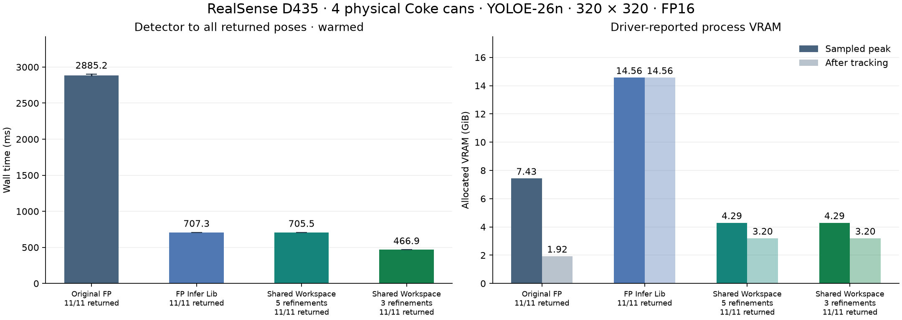
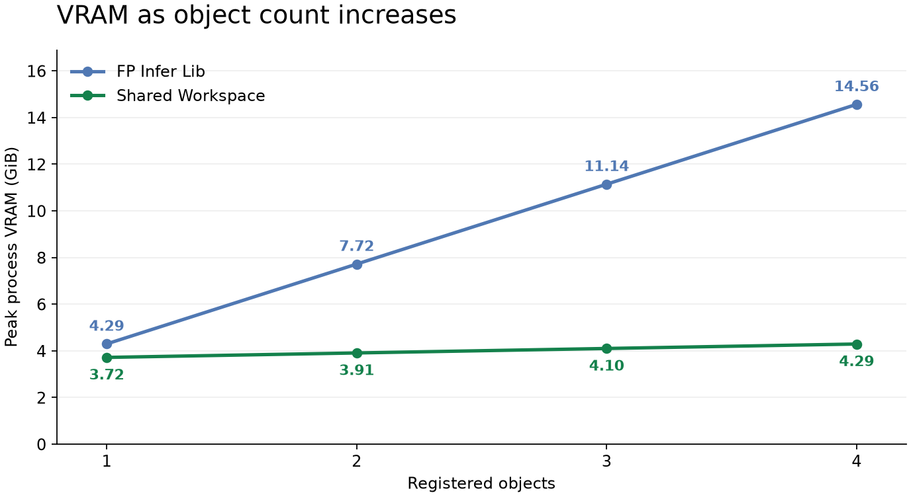

# RealSense D435 benchmark

The tests used an NVIDIA RTX PRO 6000 Blackwell Max-Q GPU with driver 595.99.02, a RealSense D435 running firmware 5.13.0.50 and aligned 640 × 480 RGB-D at 30 FPS. Each implementation received the same frames in the paired comparisons.

## Four physical cans

All four runtimes replayed the same 16 D435 frames with a warmed 320 × 320 YOLOE-26n TensorRT FP16 detector at confidence 0.25. Each runtime returned all four poses on every one of the 11 registration frames and tracked five more frames.

| Pose runtime | Model setup (s) | First all poses (ms) | Warm median / p95 (ms) | Peak process VRAM (GiB) | Median tracking (ms) | VRAM after tracking (GiB) |
|---|---:|---:|---:|---:|---:|---:|
| Original FP | 20.18 | 3699.8 | 2885.2 / 2901.1 | 7.43 | 44.32 | 1.92 |
| FP Infer Lib | 2.99 | 689.0 | 707.3 / 708.2 | 14.56 | 3.89 | 14.56 |
| Shared Workspace, 5 refinements | 2.97 | 690.6 | 705.5 / 707.3 | 4.29 | 8.87 | 3.20 |
| Shared Workspace, 3 refinements | 2.95 | 453.8 | 466.9 / 467.7 | 4.29 | 8.90 | 3.20 |

Shared Workspace with three refinements reduced the median registration time by **34%** and peak process VRAM by **71%** compared with FP Infer Lib. The same recording was used for the [object-count sweep](#vram-by-object-count).

## Three physical cans

YOLOE-26n with the prompt `soda can`, a 320 × 320 TensorRT FP16 engine and confidence 0.25 found all three cans on all 16 recorded frames. Each runtime returned all three poses on 11 of 11 registration frames. The remaining five frames were used for tracking.

| Pose runtime | Model setup (s) | First all poses (ms) | Warm median / p95 (ms) | Peak process VRAM (GiB) |
|---|---:|---:|---:|---:|
| Original FP | 15.26 | 2910.8 | 2146.0 / 2151.7 | 7.24 |
| FP Infer Lib | 2.40 | 510.9 | 528.4 / 530.4 | 11.14 |
| Shared Workspace, 5 refinements | 2.38 | 509.1 | 521.4 / 526.4 | **4.10** |
| Shared Workspace, 3 refinements | 2.39 | **333.4** | **342.5 / 343.9** | **4.10** |

With three refinements, Shared Workspace reduced median registration latency by **35%** and peak VRAM by **63%** relative to stock FP Infer Lib. Relative to Original FP, it reduced median latency by **84%** and peak VRAM by **43%**.

With five refinements, Shared Workspace returned identical matrices to stock FP Infer Lib for all 33 paired poses. The warmed median was 521.4 ms versus 528.4 ms, and peak VRAM dropped from 11.14 GiB to 4.10 GiB.

The large workspace is shared across objects. Mesh buffers and pose state still consume memory per object. The one-can and three-can runs used different YOLOE resolutions, so their peaks reflect both detector configuration and object count.

## One physical can

Each runtime used the same 224 × 224 YOLOE-26n TensorRT FP16 detector and returned a pose on all 21 paired frames. The warmed percentiles use the 20 registrations after the first return.

| Pose runtime | Model setup (s) | First all poses (ms) | Warm median / p95 (ms) | Peak process VRAM (GiB) |
|---|---:|---:|---:|---:|
| Original FP | 7.37 | 1575.3 | 725.9 / 729.2 | 6.84 |
| FP Infer Lib | 1.63 | 228.1 | 175.5 / 176.0 | 4.25 |
| Shared Workspace, 5 refinements | 1.63 | 230.2 | 175.8 / 176.2 | **3.68** |
| Shared Workspace, 3 refinements | 1.62 | **173.5** | **116.3 / 116.7** | **3.68** |

### Live single-can startup

Both configurations used the three-refinement Shared Workspace runtime and returned poses on 10 of 10 trials. Model setup and camera warmup preceded the timed trials.

| Detector | Model setup (s) | First aligned frame to pose (ms) | First camera wait to pose (ms) | Sampled peak process VRAM (GiB) |
|---|---:|---:|---:|---:|
| YOLOE warmed during setup | 1.76 | **107.9** | **149.6** | 3.68 |
| Built-in RGB-D can detector | 1.61 | 110.4 | 152.2 | **3.45** |

## Tracking latency and retained VRAM

Each run tracked five frames after registration. Latency is the median time to update all poses on one frame, with GPU synchronization. The tracker uses the existing pose and skips detection.

| Pose runtime | One can (ms) | One can VRAM after tracking (GiB) | Three cans (ms) | Three cans VRAM after tracking (GiB) |
|---|---:|---:|---:|---:|
| Original FP | 10.65 | 1.34 | 31.94 | 1.72 |
| FP Infer Lib | 2.40 | 4.25 | 2.81 | 11.14 |
| Shared Workspace, 5 refinements | 2.45 | 2.58 | 6.64 | 3.00 |
| Shared Workspace, 3 refinements | 2.33 | 2.58 | 6.79 | 3.00 |

For three cans, stock FP Infer Lib tracked fastest at **2.81 ms** and retained **11.14 GiB**. Shared Workspace with three refinements tracked in **6.79 ms** and retained **3.00 GiB**, a **73% reduction**. Original FP retained the least memory at **1.72 GiB** and took **31.94 ms** per tracking frame.

## VRAM by object count

For this sweep, all runs replayed the same recording of four physical cans. A warmed 320 × 320 YOLOE-26n TensorRT FP16 engine at confidence 0.25 found all four cans on all 16 frames. Each run registered the first one, two, three, or four masks from left to right in a fresh process. All runs returned every requested pose on 11 registration frames and then tracked five more frames.

| Registered cans | FP Infer Lib peak (GiB) | Shared Workspace peak, 5 refinements (GiB) | Shared Workspace peak, 3 refinements (GiB) |
|---:|---:|---:|---:|
| 1 | 4.29 | 3.72 | 3.72 |
| 2 | 7.72 | 3.91 | 3.91 |
| 3 | 11.14 | 4.10 | 4.10 |
| 4 | 14.56 | 4.29 | 4.29 |

FP Infer Lib allocates a GPU workspace for each estimator. In this sweep, peak process VRAM grew by about **3.42 GiB per additional can**. Shared Workspace reuses the large buffers and added about **0.19 GiB per can** at either refinement count. With four cans it retained **3.20 GiB** after tracking, compared with **14.56 GiB** for FP Infer Lib.

To repeat the sweep, replay the same capture and YOLO TensorRT engine with `benchmark.py --take-first --objects N` for each count.

## What refinement means

A candidate pose is a guess at the object's position and rotation in the camera frame. During initial registration, FoundationPose uses the detector mask and aligned depth to estimate an initial position. The benchmark starts with **252 candidate rotations per object**.

1. Render the CAD mesh at each candidate pose. Use the camera intrinsics to align the rendered crop with the observed RGB-D crop.
2. Feed the rendered and observed crops into **RefineNet**. It predicts a translation and rotation correction. Applying that correction is **one refinement pass**.
3. Render again with the updated poses and repeat for the configured number of passes.
4. Run **ScoreNet** after the final pass and return the highest-scoring pose. That pose seeds the tracker.

**Three vs. five refinements** changes how many times the render-and-correct loop runs. Both settings start with the same 252 candidates and score them after refinement. Three passes give 756 candidate updates per object. Five passes give 1,260. Detection and final scoring still take time, and both variants reuse the same GPU workspace.

In the four-can replay, reducing the count from five to three lowered the warm median registration time from **705.5 ms to 466.9 ms**. Both variants peaked at **4.29 GiB**. The five-pass build matched stock FP Infer Lib on all 44 paired poses. Compared with the five-pass build, three passes changed the pose by a median of **0.34 mm** and **0.42°**. The largest differences were **2.00 mm** and **2.38°**. These differences measure agreement between runs. Absolute accuracy requires ground-truth poses.

**Tracking uses two refinement passes per frame** in these benchmarks. It starts from one prior pose per object and refines it against the new RGB-D frame. That avoids repeating detection, the 252-candidate search, and ScoreNet on each tracking frame. [Upstream registration and tracking architecture](https://github.com/nvidia-isaac/foundation-pose-inference-library/blob/89dd4cfec75f944b9fca52d9cb282725f1666c12/doc/ARCHITECTURE.md)

## How to read the numbers

Model setup includes detector and pose runtime initialization. The first and warmed registration timings start with an aligned frame in host memory after setup. They include detection, mask creation and synchronized pose registration through the last pose. The plot markers show p95. Peak process VRAM was sampled with NVML, including setup. Sampling can miss short spikes. Pose overlays were checked visually and transform deltas are relative to the stock TensorRT output. Absolute 6D accuracy was not measured against ground truth.

Shared Workspace results are reference measurements from a private local build. The repository contains the dashboard, benchmark tools, upstream pose submodules and the soda-can scan.
