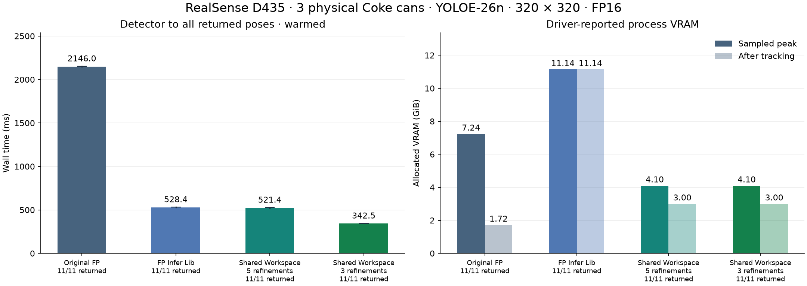
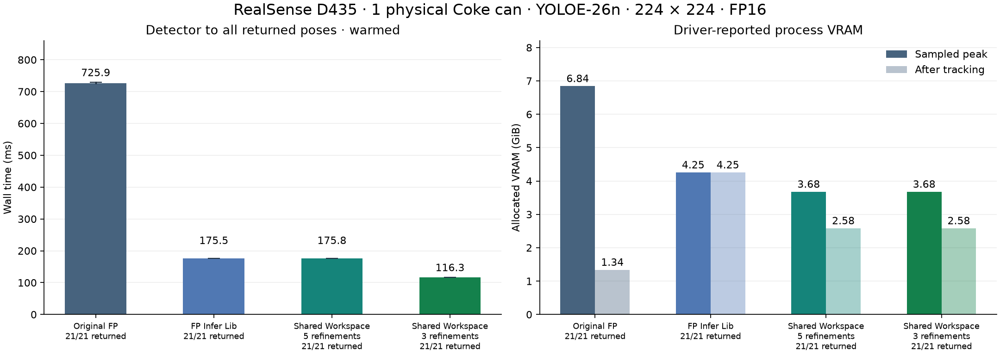

# RealSense D435 benchmark

The tests used an NVIDIA RTX PRO 6000 Blackwell Max-Q GPU with driver 595.99.02, a RealSense D435 running firmware 5.13.0.50 and aligned 640 × 480 RGB-D at 30 FPS. Each implementation received the same frames in the paired comparisons.

## Three physical cans

YOLOE-26n with the prompt `soda can`, a 320 × 320 TensorRT FP16 engine and confidence 0.25 found all three cans on all 16 recorded frames. Each runtime returned all three poses on 11 of 11 registration frames. The remaining five frames were used for tracking.

| Pose runtime | Median all-pose registration (ms) | Sampled peak process VRAM (GiB) | After tracking (GiB) |
|---|---:|---:|---:|
| Original FP | 2146.0 | 7.24 | 1.72 |
| FP Infer Lib | 528.4 | 11.14 | 11.14 |
| Shared Workspace, 5 refinements | 521.4 | 4.10 | 3.00 |
| Shared Workspace, 3 refinements | **342.5** | **4.10** | **3.00** |

The three-refinement Shared Workspace run reduced median registration latency by **35%** and peak process VRAM by **63%** relative to FP Infer Lib. Five refinements produced identical pose matrices for the 33 paired poses.

The Shared Workspace build reuses its large GPU workspace across objects. Per-object allocations still contribute to total process VRAM. The one-can and three-can YOLOE runs used different input resolutions, so their peak VRAM difference includes detector configuration as well as object count.

## One physical can

Each runtime returned a pose on all 21 paired frames. The warmed percentiles use the 20 registrations after the first return.

| Pose runtime | First pose (ms) | Warm median / p95 (ms) | Sampled peak process VRAM (GiB) |
|---|---:|---:|---:|
| Original FP | 1575.3 | 725.9 / 729.2 | 6.84 |
| FP Infer Lib | 228.1 | 175.5 / 176.0 | 4.25 |
| Shared Workspace, 5 refinements | 230.2 | 175.8 / 176.2 | 3.68 |
| Shared Workspace, 3 refinements | **173.5** | **116.3 / 116.7** | **3.68** |

### Live single-can startup

Both configurations used the three-refinement Shared Workspace runtime and returned poses on 10 of 10 trials. Model setup and camera warmup preceded the timed trials.

| Detector | Model setup (s) | First aligned frame to pose (ms) | First camera wait to pose (ms) | Sampled peak process VRAM (GiB) |
|---|---:|---:|---:|---:|
| YOLOE warmed during setup | 1.76 | **107.9** | **149.6** | 3.68 |
| Built-in RGB-D can detector | 1.61 | 110.4 | 152.2 | **3.45** |

## How to read the numbers

Paired registration includes detection, mask creation and synchronized pose registration on a frame already in host memory. The plot markers show p95. Peak process VRAM was sampled with NVML, including setup. Sampling can miss short spikes. Pose overlays were checked visually and transform deltas are relative to the stock TensorRT output. Absolute 6D accuracy was not measured against ground truth.

Shared Workspace results are reference measurements from a private local build. The repository contains the dashboard, benchmark tools, upstream pose submodules and the soda-can scan.
